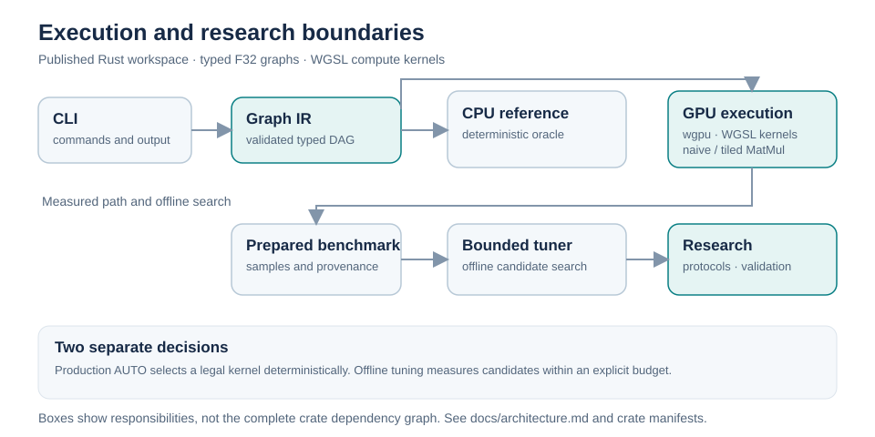
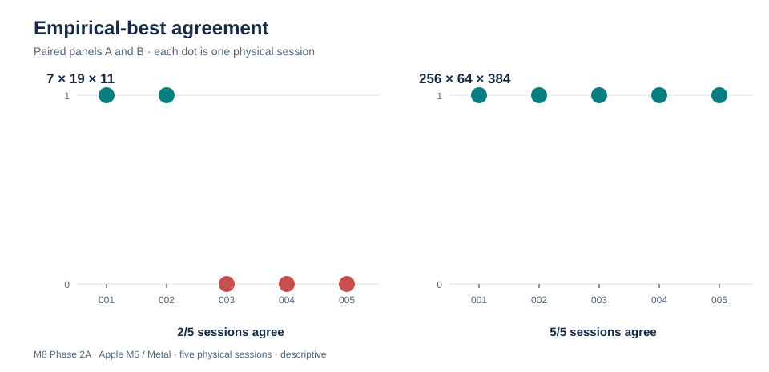
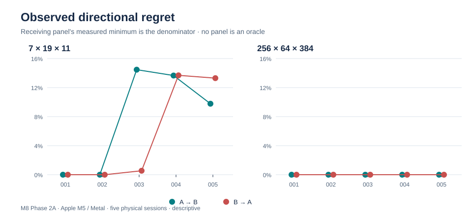
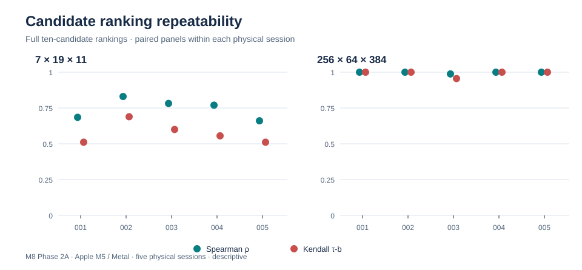
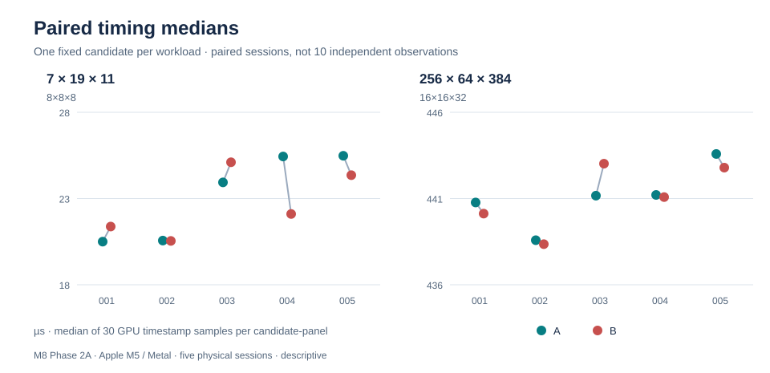

# ConstraintForge

**Rust-first GPU execution and bounded autotuning research prototype.** ConstraintForge represents small F32 neural-network graphs as a typed DAG, runs a deterministic CPU reference, and executes complete graphs with `wgpu` and WGSL. Its prepared benchmark and offline tuner preserve raw measurements and enforce explicit budgets. The public v0.1.0 release includes a qualified five-session M8 study; it is a research artifact, not a production inference service or general-purpose compiler.

## At a glance

| Area | What is published |
| --- | --- |
| Compiler and execution | Typed row-major F32 MatMul, BiasAdd, and ReLU graphs; CPU reference; GPU-resident intermediate tensors; naive and tiled MatMul kernels. |
| Scheduling research | Deterministic production AUTO selection, separate bounded offline candidate tuning, prepared GPU timing, and provenance-rich raw records. |
| M8 evidence | Five Apple M5/Metal physical sessions, two workloads, 600 measurement blocks, 6,000 retained GPU timestamp samples, a final report, and independently reproduced analysis. |

## Architecture



The CLI exposes the graph, reference, GPU, benchmarking, tuning, and research crates. The IR defines graph meaning; the CPU path is the correctness reference. GPU execution uses `wgpu` compute and keeps intermediate graph tensors on the device. Prepared benchmarking feeds offline tuning and research records. Production AUTO chooses a legal kernel deterministically and does not run the tuner. See [architecture details](docs/architecture.md) and the [diagram source and scope](docs/assets/README.md).

## CPU-only quick start

Install Rust 1.87 or newer with `rustfmt` and `clippy`. The workspace uses Rust 2024 and a pinned `Cargo.lock`.

```sh
cargo run --locked -p constraintforge-cli -- demo --backend cpu
cargo run --locked -p constraintforge-cli -- demo --backend cpu --example mlp
cargo run --locked -p constraintforge-cli -- tune candidates --m 128 --k 128 --n 128
```

These commands use the CPU or list candidate configurations; they do not request a GPU. For the command inventory, run `cargo run --locked -p constraintforge-cli -- --help`. Measured tuning and benchmarks require a suitable GPU and explicit command selection. GPU requests never silently fall back to CPU. See [benchmark methodology](docs/benchmark-methodology.md) and [tuning methodology](docs/tuning-methodology.md) before comparing timings.

## M8: paired reference panels

The prospective M8 Phase 2A study measured two independently scheduled panels per workload in each of five physical Apple M5/Metal sessions. Each panel covered ten frozen MatMul candidates with three blocks of ten GPU timestamp samples. All 600 correctness admissions passed the frozen runner validation. The final deterministic analysis was independently reproduced byte-for-byte. The independent unit is the **physical session (n = 5)**; panels, candidates, blocks, and samples are nested or paired observations.

| Workload | Exact empirical-best agreement | Largest observed directional regret | Full-ranking agreement |
| --- | ---: | ---: | --- |
| `7×19×11` | 2/5 sessions | 14.4691% | Positive but imperfect across all five sessions. |
| `256×64×384` | 5/5 sessions | 0% | Nearly exact across all five sessions. |



Panels disagree on the small workload in three sessions; all five large-workload sessions agree. Each dot is one paired session.



Regret applies one panel's empirical best to the other panel's measured results. Neither panel is an oracle. Values are descriptive, not a claim about a true optimum.



Spearman correlation and Kendall tau-b compare complete ten-candidate rankings within each session.



The timing figure shows the two panel medians for one illustrative candidate per workload, chosen after analysis and held fixed across sessions. Each median summarizes 30 retained GPU timestamp samples. The ten panel points are paired, not independent replicates; the chart does not pool sample-level outliers into an inferential distribution.

Read the [qualified scientific report](research/analysis/m8-phase2a-five-session-final-report.md), [frozen protocol](research/protocols/m8-phase2a-v1.toml), [raw evidence and CPU-only reproduction guide](research/evidence/m8-phase2a/REPRODUCE.md), and [figure generation and data sources](docs/assets/README.md).

**Scope of inference:** This is a descriptive one-device, two-workload pilot with five physical sessions. Workload diversity is limited; thermal and GPU-load telemetry is incomplete. The frozen protocol specified no inferential interval, significance test, or independent true-optimum measurement. These observations do not establish universal performance improvements, causality, cross-hardware validity, or algorithmic novelty. M9 remains unfinished and is not part of the public source release.

## Reproduce and verify

```sh
cargo fmt --all -- --check
cargo clippy --locked --workspace --all-targets -- -D warnings
cargo test --locked --workspace
```

Hardware-dependent tests are ignored by default and require a separately chosen adapter. Passing CPU-only checks is not evidence of GPU execution. The [M8 reproduction guide](research/evidence/m8-phase2a/REPRODUCE.md) gives CPU-only validation and analysis commands over the published records. The original scientific evidence and v0.1.0 tag remain historical release artifacts; these presentation figures are derived views added after that release. `RELEASE-SHA256SUMS` describes the tagged v0.1.0 inventory, not this subsequent documentation update on `main`.

## License

Project-owned code, WGSL kernels, documentation, and reviewed research artifacts are licensed **MIT OR Apache-2.0**, at your choice. See [LICENSE-MIT](LICENSE-MIT), [LICENSE-APACHE](LICENSE-APACHE), and the [research artifact licensing scope](research/RESEARCH_LICENSE.md). Dependencies retain their applicable licenses and notices; see the [third-party inventory](THIRD_PARTY_LICENSES.md). No compiled binaries are distributed here.
